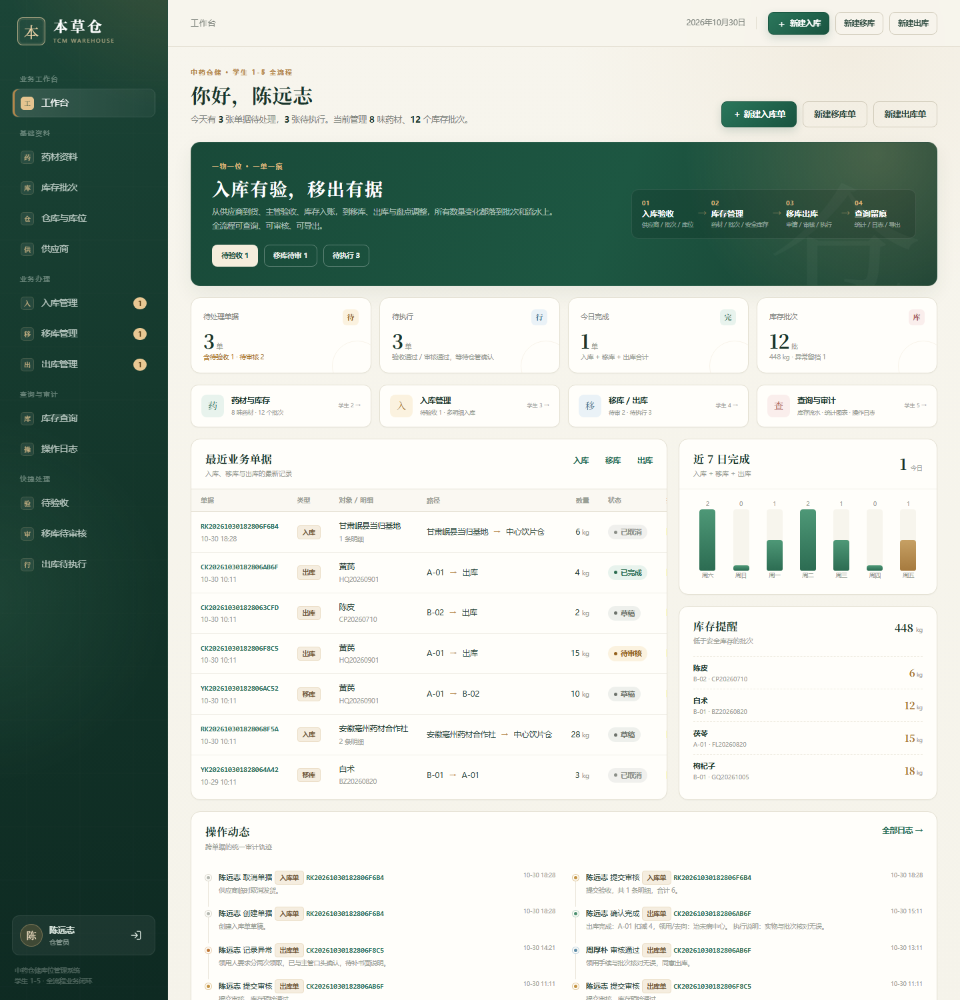
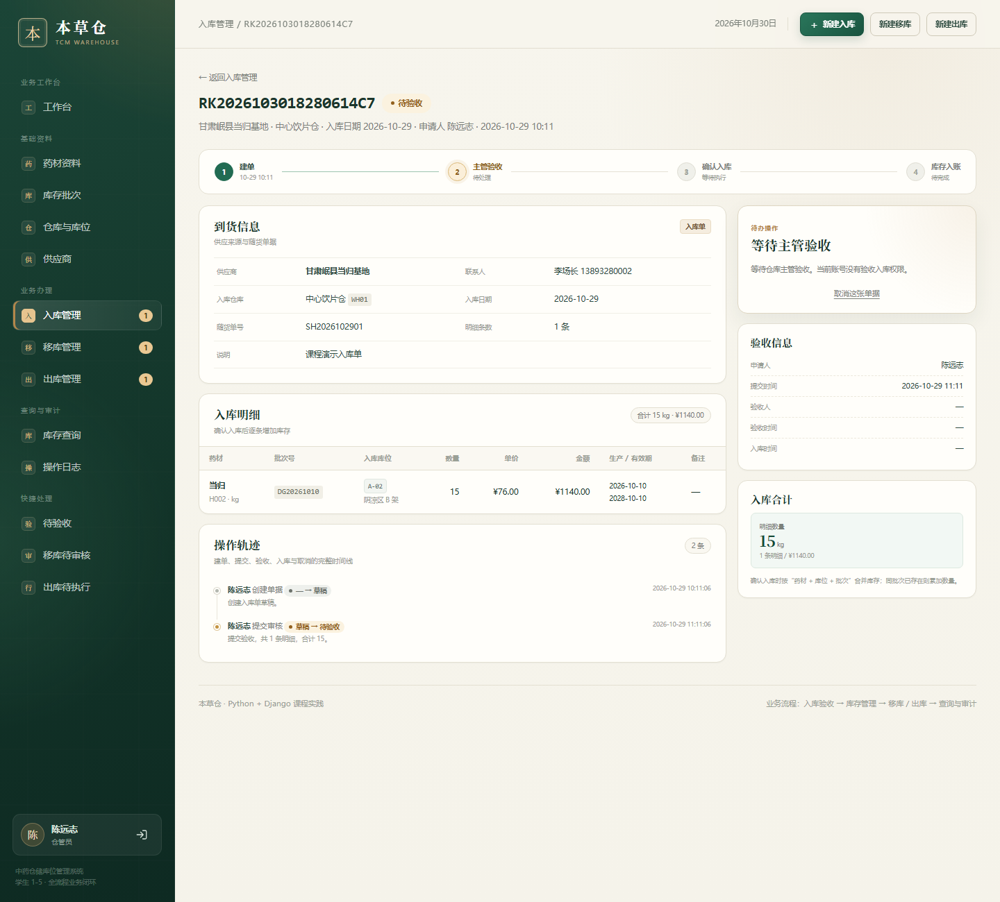
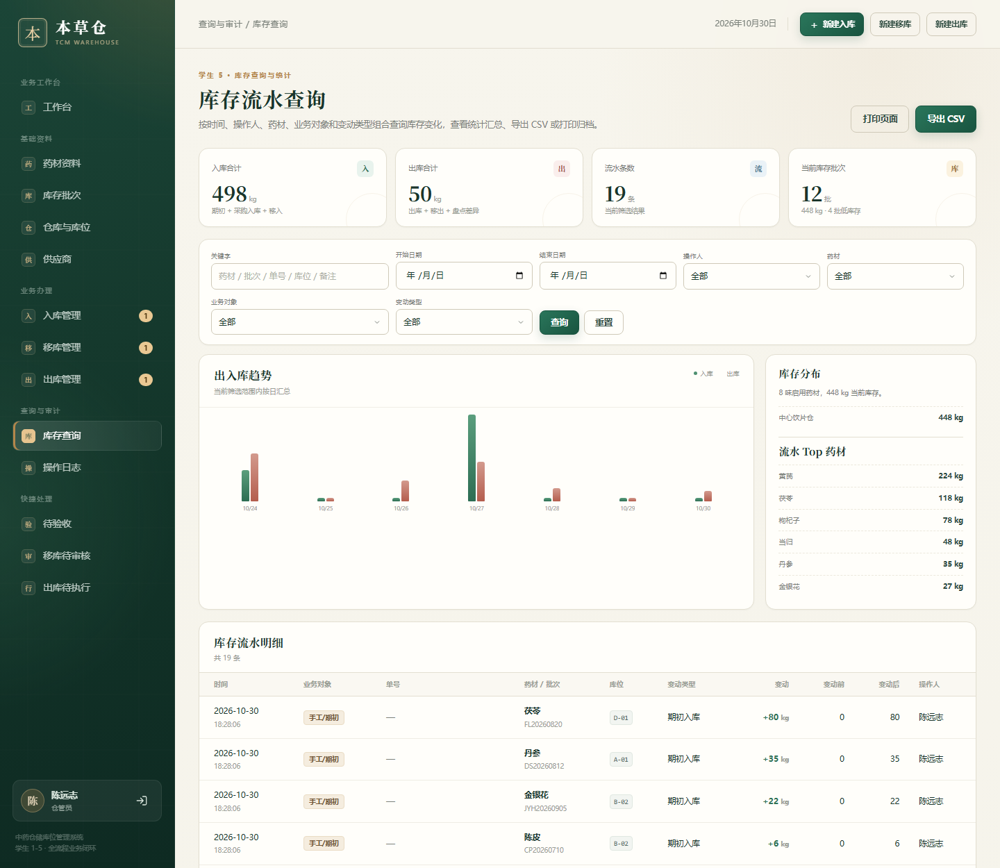
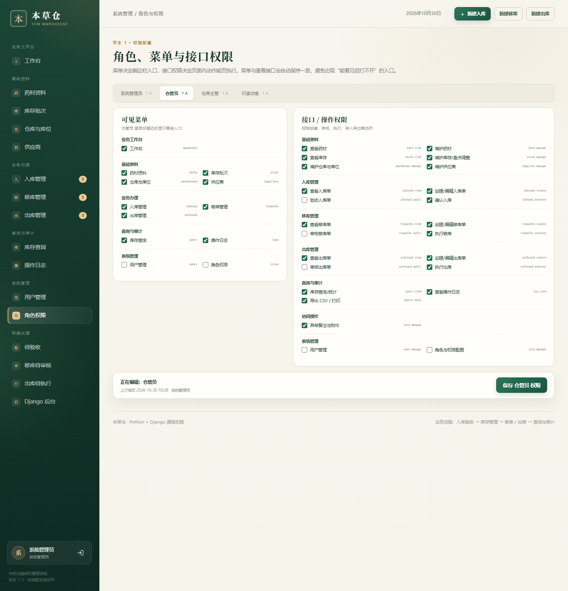
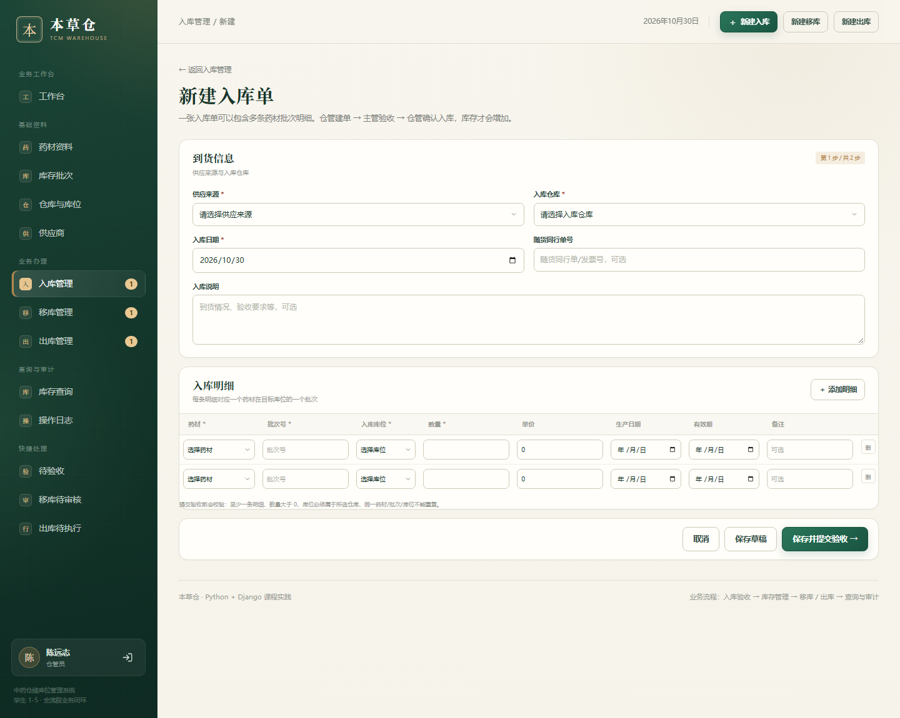
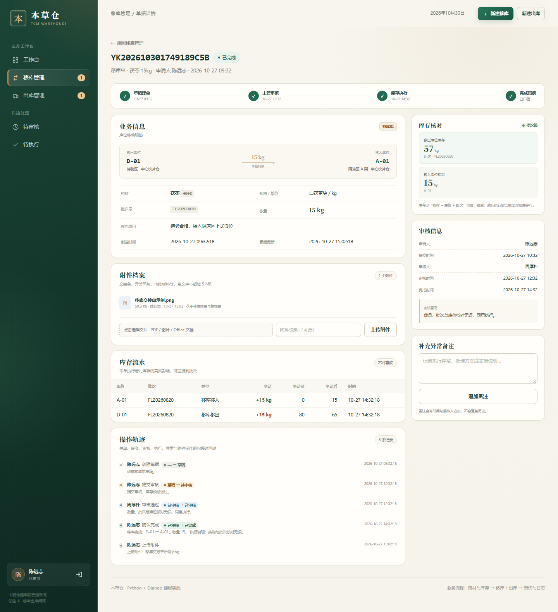

# 本草仓 · 中药仓储库位管理系统（学生 1-5 完整版）

面向《基于 Python + Django 的中药仓储库位管理系统》课程实践，完整实现 **学生 1 到学生 5** 的全部功能包：用户与仓库资料、药材与库存、入库管理、移库出库管理、库存查询与日志。

系统以“药材 + 库位 + 批次”为库存事实来源，覆盖 **入库验收 → 库存管理 → 移库/出库 → 查询审计** 的业务闭环。所有库存变化都通过业务单据或盘点调整产生，并留下可查询、可导出的流水与操作轨迹。

---

## 界面预览

| 完整工作台 | 入库单详情 |
| --- | --- |
|  |  |

| 库存查询与统计 | 角色 / 菜单 / 接口权限 |
| --- | --- |
|  |  |

| 多明细入库建单 | 移库单与库存流水 |
| --- | --- |
|  |  |

---

## 一、五个功能包完成情况

### 学生 1：用户与仓库资料

- 用户注册、登录、退出；注册用户默认为“只读访客”，由管理员分配岗位。
- 用户管理：创建用户、分配仓管员/主管/管理员角色、启停账号、重置密码。
- 仓库与库位维护：新增、编辑、启停、删除；有关联库存或单据时禁止删除并提示改为停用。
- 供应商档案维护，用于入库单的货源追溯。
- **角色、菜单、接口权限配置**：管理员可在 `/settings/roles/` 按角色勾选可见菜单和接口动作，保存后侧边栏与页面操作立即生效。

### 学生 2：药材与库存管理

- 药材新增、编辑、详情、删除/停用；编码、名称、规格、单位、类别、安全库存。
- 药材列表支持关键字、类别、启用状态筛选和分页。
- 库存批次按“药材 + 库位 + 批次”管理，支持新增、详情、筛选、低库存筛选和分页。
- 库存编辑支持生产日期/有效期维护；数量变化必须填写原因并生成 **ADJUST** 盘点调整流水，不能直接覆盖历史。
- 药材详情展示总库存、批次分布和最近库存流水；库存详情展示完整批次流水。

### 学生 3：入库管理

- 入库单创建、编辑、删除草稿；支持多药材、多批次、多库位明细。
- 明细行可动态增加/删除，维护药材、批次、目标库位、数量、单价、生产/有效期、备注。
- 校验：至少一条明细、数量大于 0、库位必须属于入库仓库、同单同药材/批次/库位不能重复。
- 状态流：草稿 → 待验收 → 验收通过 → 已入库；支持驳回、取消。
- 入库单列表支持状态、供应商、关键字、日期筛选和分页；详情展示状态轨迹、验收信息和合计金额。
- 确认入库时逐条创建/合并库存批次并生成 **INBOUND** 流水。

### 学生 4：移库出库管理

- 移库单：同仓库库位到库位移动，源库位扣减、目标库位增加，总库存不变。
- 出库单：领用、报损、调拨、其他类型；审核后扣减库存。
- 状态流：草稿 → 待审核 → 已审核 → 已完成；支持驳回、取消、重复执行保护。
- 审核人与执行人岗位分离，禁止申请人自审。
- 执行时 `transaction.atomic()` + `select_for_update()` 锁定库存行；库存不足整笔回滚。
- 异常备注追加式留档；附件支持 PDF/图片/Office（≤5 MB）；完整操作轨迹与库存流水。

### 学生 5：库存查询与日志

- 按关键字、时间、操作人、药材、业务对象、变动类型多条件查询库存流水。
- 汇总卡片：入库合计、出库合计、流水条数、当前批次与低库存数。
- 出入库趋势双柱状图、库存仓库分布、流水 Top 药材。
- 操作日志按人员、动作、单据类型、时间、关键字筛选。
- CSV 导出（UTF-8 BOM，Excel 可直接打开）与打印/PDF 页面。
- 分页保留筛选条件；接口按 `query.view / log.view / export.data` 权限控制。

---

## 二、演示账号

| 账号 | 密码 | 角色 | 主要权限 |
| --- | --- | --- | --- |
| `keeper` | `keeper123` | 仓管员 | 建单、入库执行、移库/出库执行、药材/库存/仓库维护 |
| `manager` | `manager123` | 仓库主管 | 入库验收、移库/出库审核、查询、日志、导出 |
| `admin` | `admin123` | 系统管理员 | 全部菜单与接口 + Django 后台 |
| `viewer` | `viewer123` | 只读访客 | 查看工作台、单据、库存、查询、日志 |

> 演示密码仅用于本地课程验收，部署前请修改。Django 后台：`/admin/`。

---

## 三、快速启动

```powershell
cd C:\Users\33139\Desktop\zuoye\demo
python -m venv .venv
.\.venv\Scripts\Activate.ps1
python -m pip install -r requirements.txt

# 已附带演示数据库 db.sqlite3，可直接启动；重建演示数据执行：
python manage.py migrate
python manage.py seed_demo --reset

python manage.py runserver
```

浏览器访问：<http://127.0.0.1:8000/>

`seed_demo` 生成：

- 4 个岗位账号；
- 2 个仓库、8 个库位；
- 8 味药材、3 家供应商、12 个库存批次（含入库带来的批次）；
- 6 张入库单，覆盖草稿/待验收/验收通过/已入库/已驳回/已取消；
- 7 张移库单、8 张出库单，覆盖六种状态；
- 4 种角色的菜单与接口权限配置；
- 示例附件与异常备注。

---

## 四、权限矩阵（默认值，可在页面修改）

| 功能 | 仓管员 | 仓库主管 | 管理员 | 只读访客 |
| --- | :---: | :---: | :---: | :---: |
| 工作台、查询、日志 | ✓ | ✓ | ✓ | ✓ |
| 药材/库存查看 | ✓ | ✓ | ✓ | ✓ |
| 药材/库存/仓库/供应商维护 | ✓ | — | ✓ | — |
| 入库单创建/编辑 | ✓ | — | ✓ | — |
| 入库验收 | — | ✓ | ✓ | — |
| 入库确认执行 | ✓ | — | ✓ | — |
| 移库/出库创建、编辑 | ✓ | — | ✓ | — |
| 移库/出库审核、驳回 | — | ✓ | ✓ | — |
| 移库/出库执行 | ✓ | — | ✓ | — |
| 异常备注/附件 | ✓ | ✓ | ✓ | — |
| 用户管理、角色配置 | — | — | ✓ | — |
| CSV 导出 | ✓ | ✓ | ✓ | — |

系统支持在“角色权限”页面调整菜单与接口权限；超级管理员始终拥有全部权限，避免误配置锁死系统。

---

## 五、核心业务规则

### 5.1 入库

```text
草稿 DRAFT → 待验收 PENDING → 验收通过 APPROVED → 已入库 COMPLETED
                    │
                    ├─ 驳回 → REJECTED → 编辑后重新提交
                    └─ 取消 → CANCELLED
```

确认入库时按“药材 + 库位 + 批次”合并库存并逐条写入 `INBOUND` 流水。

### 5.2 移库 / 出库

```text
草稿 DRAFT → 待审核 PENDING → 已审核 APPROVED → 已完成 COMPLETED
                    │                │
                    ├─ 驳回 → REJECTED
                    └─ 取消 → CANCELLED
```

- 移库：源库位减、目标库位增，总库存不变。
- 出库：指定库位扣减，生成 `OUTBOUND` 流水。
- 执行时锁定库存行；库存不足、状态不对或重复确认时整笔回滚。
- 审核人不能是申请人；只读访客只能查看。

### 5.3 库存调整

库存数量不能被普通编辑直接覆盖。盘点差异通过“编辑库存 → 调整后数量 + 调整原因”生成 `ADJUST` 流水，保留前后值与操作人。

---

## 六、主要页面 / URL

| URL | 页面 |
| --- | --- |
| `/` | 全模块工作台 |
| `/accounts/login/`、`/accounts/signup/` | 登录 / 注册 |
| `/herbs/` | 药材资料 |
| `/stock/` | 库存批次 |
| `/warehouses/`、`/suppliers/` | 仓库与库位 / 供应商 |
| `/inbound/` | 入库管理 |
| `/transfers/` | 移库管理 |
| `/outbounds/` | 出库管理 |
| `/reports/stock/` | 库存查询与统计 |
| `/reports/logs/` | 操作日志 |
| `/users/`、`/settings/roles/` | 用户管理 / 角色权限 |
| `/admin/` | Django 后台（业务单据/流水/轨迹只读） |

完整 URL、视图、方法与权限说明见 [`docs/接口与视图清单.md`](docs/接口与视图清单.md)。

---

## 七、项目结构

```text
demo/
├─ manage.py
├─ requirements.txt
├─ README.md
├─ db.sqlite3                       # 已生成的完整演示库
├─ tcm_wms/                         # Django 项目配置
├─ warehouse/
│  ├─ models.py                     # 用户角色、仓库库位、药材库存、入库/移库/出库、权限
│  ├─ access.py                     # 菜单与接口权限定义/默认值
│  ├─ permissions.py                # 权限判定与装饰器
│  ├─ services.py                   # 入库/移库/出库/盘点事务与库存联动
│  ├─ forms.py                      # 全模块表单、入库明细 formset
│  ├─ views.py                      # 工作台、移库出库闭环
│  ├─ inbound_views.py              # 学生 3 入库
│  ├─ catalog_views.py              # 学生 2 药材/库存
│  ├─ system_views.py               # 学生 1 用户/仓库/角色
│  ├─ report_views.py               # 学生 5 查询/日志/导出
│  ├─ admin.py
│  ├─ urls.py
│  ├─ migrations/                   # 0001-0003 数据库迁移
│  ├─ management/commands/seed_demo.py
│  ├─ templatetags/
│  └─ tests/                        # 71 个自动化测试
├─ templates/                       # 中文服务端模板
├─ static/warehouse/                # 无依赖 CSS / JS
├─ media/                           # 示例附件
├─ demo_assets/                     # 交接单图片源
├─ sql/
│  ├─ init_mysql.sql
│  └─ schema_sqlite.sql
└─ docs/
   ├─ 全模块功能说明.md
   ├─ 项目类与接口说明_中英对照.md / .docx
   ├─ 学生4_功能说明.md
   ├─ 接口与视图清单.md
   ├─ 测试用例.md
   ├─ 演示脚本.md
   ├─ 验收清单.md
   └─ screenshots/
```

---

## 八、测试

```powershell
python manage.py test warehouse -v 2
```

当前结果：

```text
Found 71 test(s).
System check identified no issues (0 silenced).
.......................................................................
Ran 71 tests in 28.088s
OK
```

覆盖：注册/用户/角色权限、仓库库位、药材与库存、入库全流程、移库/出库状态机、并发库存回滚、附件、查询筛选、CSV 导出、日志与越权访问。

详细测试清单见 [`docs/测试用例.md`](docs/测试用例.md)。

---

## 九、MySQL 切换

```powershell
mysql -u root -p < sql/init_mysql.sql

$env:DB_ENGINE = "mysql"
$env:DB_NAME = "tcm_wms"
$env:DB_USER = "root"
$env:DB_PASSWORD = "你的密码"
$env:DB_HOST = "127.0.0.1"
$env:DB_PORT = "3306"

python -m pip install mysqlclient
python manage.py migrate
python manage.py seed_demo --reset
python manage.py runserver
```

`sql/init_mysql.sql` 负责建库和字符集；业务表以 Django 迁移 `warehouse/migrations/` 为唯一建表依据，避免手写 SQL 与模型漂移。`sql/schema_sqlite.sql` 是当前完整结构的 SQLite 参考导出。

---

## 十、设计说明

1. **库存以“药材 + 库位 + 批次”为唯一维度**，同批次可分布在多个库位。
2. **所有库存变化都通过服务层事务完成**，禁止后台直接改数量；审计表在 Django Admin 中只读。
3. **状态机集中在 `services.py`**，视图只处理权限、表单和消息，便于测试与复用。
4. **权限配置数据库化**：`RolePermission` 存储菜单与接口权限，`access.py` 提供默认值，超级管理员兜底全部权限。
5. **审计闭环**：`OrderStatusLog` 记录所有状态动作，`StockMovement` 记录每次库存前后值，附件与异常备注单独留档。
6. **可合并性**：`warehouse` 是独立 Django app，角色、菜单、查询接口均可被小组其他模块复用。
7. **扩展方向**：多级审批、库存预留、批量导入、扫码枪、消息通知、对象存储附件、REST API。

---

## 十一、交付清单

- [x] 学生 1-5 全部功能源码
- [x] 可运行演示数据库与 `seed_demo`
- [x] Django 迁移 + MySQL 初始化 + SQLite 结构脚本
- [x] 71 个自动化测试
- [x] 完整功能说明、接口清单、测试用例、演示脚本、验收清单
- [x] 双语《类、接口与方法说明》Word/Markdown 文档
- [x] 核心页面截图
- [x] 完整提交 zip 包：`中药仓储管理系统_完整版_提交包.zip`


